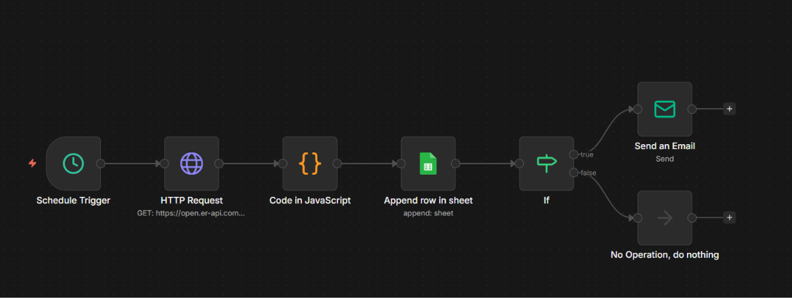

# 💱 Otomatik Döviz ve Piyasa Takip Asistanı (n8n ETL Otomasyonu)

Her gün belirlenen saatte otomatik tetiklenerek canlı **USD/TRY** ve **EUR/TRY** kurlarını çeken, belirlenen kritik eşik değerlerine göre risk analizi yapan, verileri **Google Sheets** üzerinde tarihsel veri tabanına kaydeden ve eşik aşımlarında otomatik **E-Posta Uyarısı** gönderen uçtan uca bir ETL (Extract - Transform - Load) otomasyon projesidir.

---

## 🚀 Özellikler ve İş Akışı (ETL Mimarisi)

1. **Zamanlayıcı (Schedule Trigger):** Her gün sabah **09:00 (UTC+3)** saatinde insan müdahalesi olmadan otomatik çalışır.
2. **Extract (Veri Çekme - HTTP Request):** Ücretsiz ve API anahtarı gerektirmeyen `open.er-api.com` servisi üzerinden canlı `TRY` bazlı döviz kurlarını çeker.
3. **Transform (Dönüştürme & Çift Eşik Analizi - JavaScript Code):** 
   - Ham oranları matematiksel olarak tersleyerek (`1 / oran`) gerçek **Dolar/TL** ve **Euro/TL** değerlerini hesaplar.
   - İki para birimi için ayrı kritik eşik kontrolü yapar (**Dolar ≥ 50.00 TL** ve **Euro ≥ 55.00 TL**).
4. **Load (Veri Kaydı - Google Sheets):** Tarih, Dolar/TL, Euro/TL, Dolar Durumu, Euro Durumu ve Genel Durum bilgilerini bulut tablosuna yeni satır olarak işler.
5. **Koşullu Bildirim (IF + SMTP Email):** Kurlardan en az biri kritik eşiği aştığında (`KRİTİK SEVİYE`) ilgili yöneticiye anlık bilgilendirme e-postası gönderir; normalse akışı sessizce tamamlar.

---

## 🛠️ Kurulum ve Kullanım Adımları

1. **Google Sheets Hazırlığı:** Google Drive hesabınızda yeni bir tablo oluşturun ve ilk satıra (`A1:F1`) şu sütun başlıklarını birebir ekleyin:
   `Tarih` | `Dolar_TL` | `Euro_TL` | `Dolar_Durum` | `Euro_Durum` | `Genel_Durum`
2. **Workflow İçe Aktarma:** Bu depodaki `Doviz_Takip_Asistani_Public.json` dosyasını indirin ve kendi n8n arayüzünüzde **Import from File** seçeneğiyle yükleyin.
3. **Kimlik Bilgileri (Credentials):** **Google Sheets** ve **Send an Email** düğümlerine kendi hesap bağlantılarınızı tanımlayın.
4. **Eşik Özelleştirme:** İhtiyacınıza göre **Code in JavaScript** düğümü içerisindeki `dolarKritikEsik` ve `euroKritikEsik` değişkenlerini güncelleyerek akışı aktif hale getirin.
